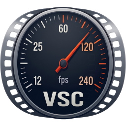

# VideoSpeedControl



VideoSpeedControl gives you full control over the speed of a video clip.

Split a clip that was recorded in native slow motion into sections and give each section its
own frame rate. For example: speed up the beginning, follow with extreme slow motion, switch
to real time, and end in slow motion again.

You can export in three ways:

- **Lossless** – no re-encoding at all. The app turns your clip into a variable-frame-rate
  clip in practically no time.
- **Smart re-encode** – only the sections whose frame rate differs from the output frame rate
  are re-encoded, in the same codec as the source. That keeps the export fast.
- **Re-encode** – the whole clip in a codec of your choice, with the same full control over
  speed and output frame rate as in the other modes.

The app saves the speed edits of every clip, so you can resume your work later – or encode
the same clip in different codecs to compare them, helped by automatically generated file
names with naming options.

You can also collect many clips – or several versions of the same clip – in a batch list and
export them all in one go.

Windows and Linux.

- **User guide:** [vsc/docs/manual.md](vsc/docs/manual.md) – also in the app (Help → User
  guide, F1) and as [PDF](vsc/docs/VideoSpeedControl_Manual.pdf)
- Feature set and milestones: [SCOPE.md](SCOPE.md)

## Setup

```bash
python3 -m venv .venv
.venv/bin/pip install -r requirements.txt      # Windows: .venv\Scripts\pip
.venv/bin/python tools/fetch_ffmpeg.py          # downloads the bundled FFmpeg
.venv/bin/python tools/fetch_rife.py            # RIFE AI interpolation (Vulkan GPU, ~430 MB download)
.venv/bin/python tools/build_sonic.py           # sound time-stretching (one C file, needs gcc)
.venv/bin/python tools/fetch_avm.py             # optional: AV2 (builds AVM, needs cmake + nasm)
```

Artwork and documentation:

```bash
.venv/bin/python tools/make_icons.py            # icons + start screen from assets/*.webp
.venv/bin/python tools/build_docs.py [--screenshots]   # PDF user guide (and new screenshots)
```

## GUI

```bash
.venv/bin/python -m vsc.gui [clip.mp4 ...]       # or drag & drop files into the window
```

## Command line (core, for testing)

```bash
.venv/bin/python -m vsc info clip.mp4
.venv/bin/python -m vsc encode clip.mp4 -o out --fps 25                    # lossless retime
.venv/bin/python -m vsc encode clip.mp4 -o out --fps 50 --start 100 --end 900   # trimmed (keyframes)
.venv/bin/python -m vsc encode clip.mp4 -o out --fps 25 --speed 0.05 --codec x264 --interp mci
.venv/bin/python -m vsc encode clip.mp4 -o out --fps 25 --speed 0.05 --codec x264 --interp rife
.venv/bin/python -m vsc encode clip.mp4 -o out --codec prores --profile hq --size 1920x1080
.venv/bin/python -m vsc encoders
```

## Packaging

```bash
.venv/bin/pip install pyinstaller
.venv/bin/python -m PyInstaller packaging/VideoSpeedControl.spec --noconfirm   # → dist/VideoSpeedControl/
```

The bundle contains FFmpeg, RIFE, Sonic and (if built) AVM from `vendor/`. Windows installers are built
by GitHub Actions (`.github/workflows/windows.yml`). Pushing a tag `vX.Y.Z` that matches
`vsc/__init__.py` creates a release with `VideoSpeedControl-X.Y.Z-setup.exe`. A test build can
be started by hand under Actions → "Windows build" → Run workflow.

## License & Attribution

- **Concept, Architecture & Design:** Alex Vulcu
- **Implementation:** Developed and curated by Alex Vulcu with AI-assisted code generation.
- **License:** Distributed under the [MIT License](LICENSE).

The bundled tools keep their own licences – FFmpeg (GPL v3 build), Qt / PySide6 (LGPL v3),
rife-ncnn-vulkan (MIT), AVM (BSD-3-Clause-Clear). See
[THIRD_PARTY_NOTICES.md](THIRD_PARTY_NOTICES.md), including what distributing a package with
them requires.
