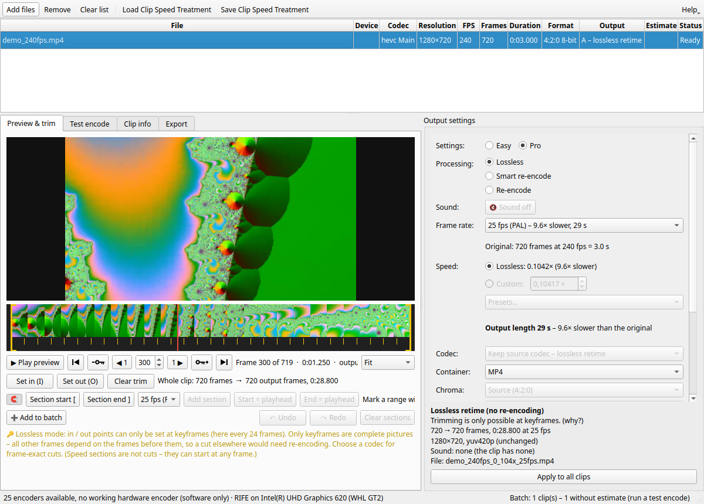
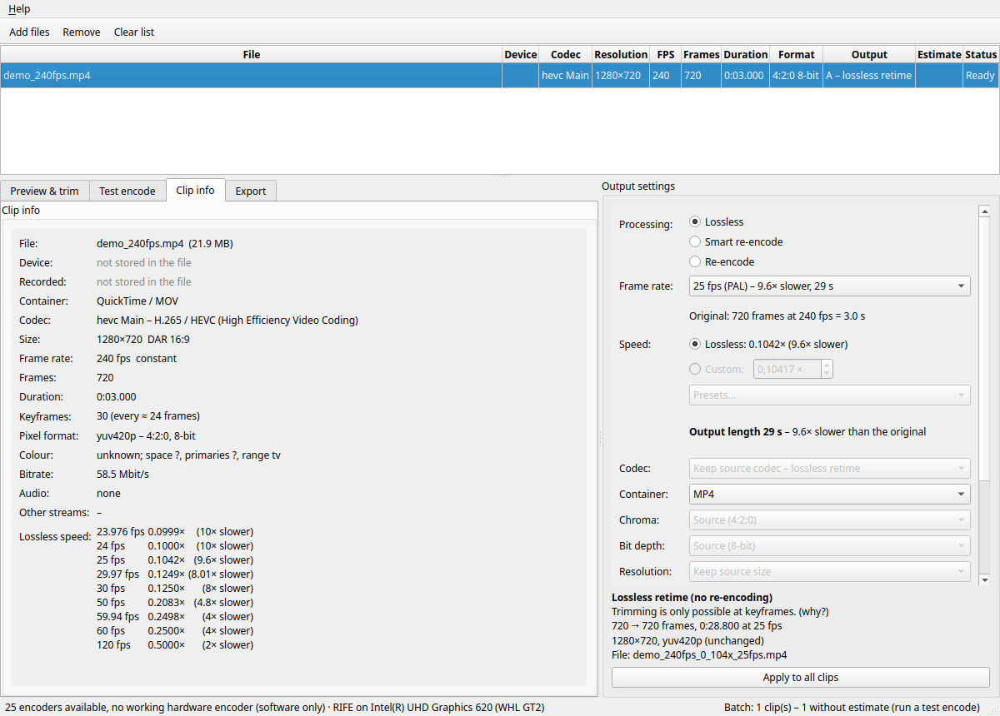
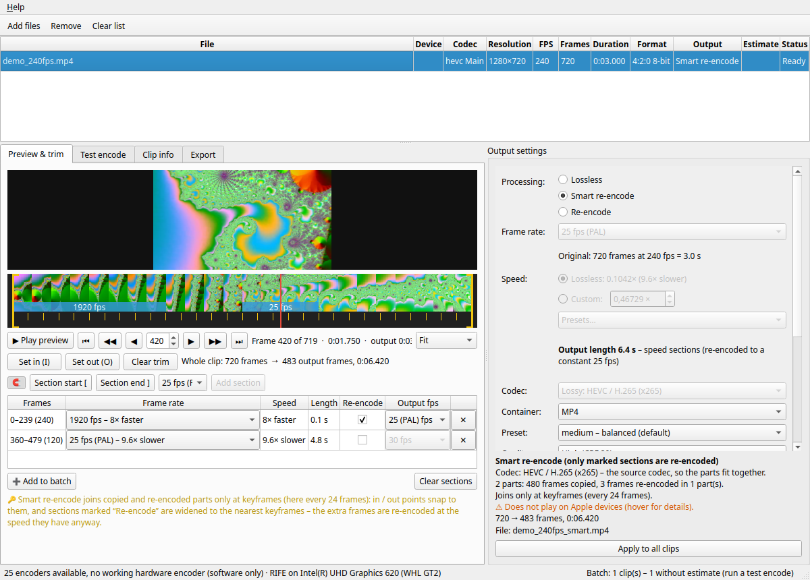
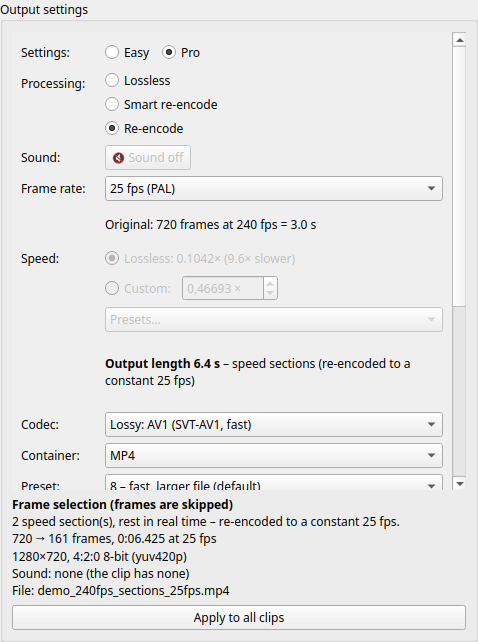
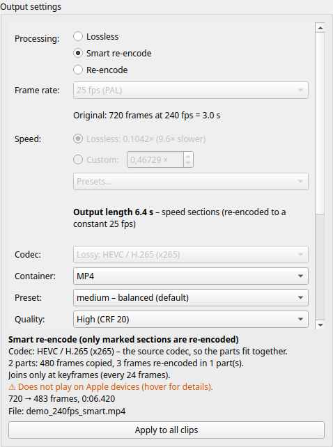
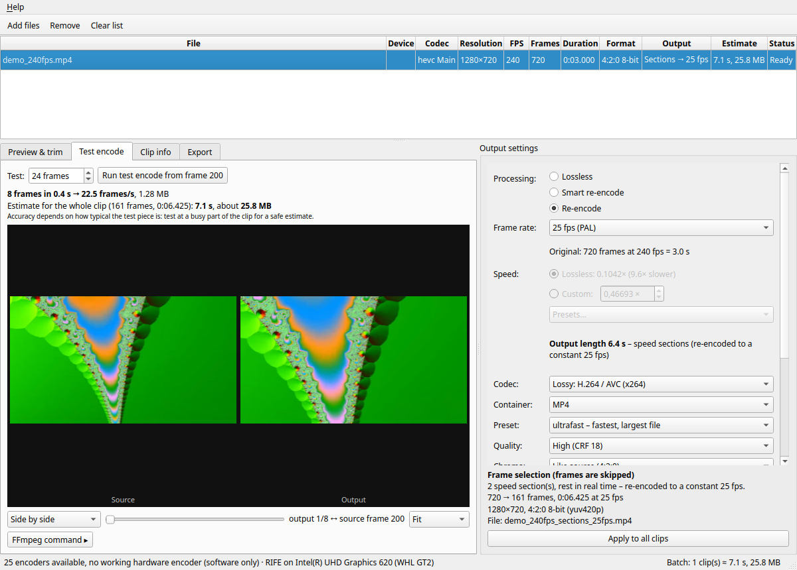
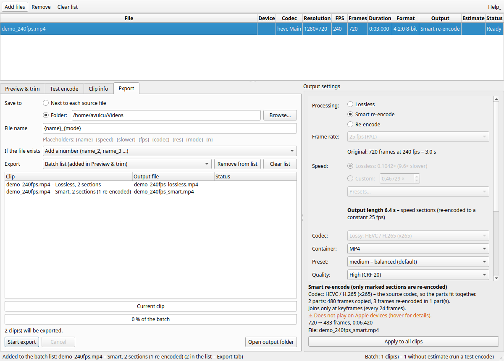

# VideoSpeedControl lo'wI' QIn

VideoSpeedControl HaStaHom Do Hoch SeHlaH. HaStaHom QIt vIHbogh qonta' (rap: GoPro 240 fps pagh ghogh HablI' QIt vIH qonta') 'ay'mey DalIm, 'ej 'ay' Hoch mIllogh Do Dotlh ghajmoH: Hoch nom, ghIq QIt law'qu', ghIq poH vIt, 'ej QIt vIHqa'.

- **naQ** chenqa'moH poQbe': mIllogh Hoch ngo' pollu', poH neH choHlu'. vaj ghun HaSta mIllogh Do choHlaHbogh nom Qapla', QaQghach luj Hutlh.
- **Smart chenqa'moH** 'ay'mey lel mIllogh Do rurbe'bogh neH chenqa'moH, Hal codec rap. vaj lel nom.
- **chenqa'moH** HaStaHom naQ codec DawIvbogh Daq chenqa'moH, Do lel mIllogh Do je Hoch SeHlaH.

ghun HaStaHom Hoch Do choHmey pol, vaj lunDaq Qu' taghqa'laH – pagh HaStaHom wa' codecmey law' Daq chenqa'moH 'ej cha'laH. ghItlh pong rapbogh ghun chenmoH; pong tlhIlHal ghajlaH. HaStaHom law' (pagh HaStaHom wa' Segh law') ghom tetlhDaq chelDI', wa'logh Hoch lellaH.

**Contents**

1. nom tagh
2. ghun yoD
3. HaStaHom lIH, HaStaHom De'
4. cha'wI' & pe'
5. lel ghuHmey
6. 'ay'mey Do
7. Smart chenqa'moH
8. nID chenqa'moH, poH 'ar chaq
9. lel, ghom tetlh
10. HaStamey tIchoHmoH
11. AV2 (nID Qu')
12. SIrgh nIvmey
13. QeD, Qagh tlhoy
14. chaw', pong

## 1. nom tagh

1. VideoSpeedControl yIchu', 'ej HaSta ghItlh wa' pagh law' yoDDaq yIluH (pagh **ghItlhmey yIchel…** yIHot).
2. *lel ghuHmey* Daq (ngoDDaq) **mIw** yIwIv. **naQ** 'oH motlh, 'ej nomqu'.
3. lel **mIllogh Do** yIwIv. tetlh bIngDaq tu'lu': HaStaHom 'arlogh QIt (pagh nom), tIq 'ar je, rap *"25 fps (PAL) – 9.6× QIt, 1:12 min"*.
4. *cha'wI' & pe'* tetlhDaq **Space** yIHot, 'ej Qap yIlegh.
5. **lel tetlh** yIpoSmoH, 'aplo' yIwIv 'ej **lel yItagh** yIHot.

### naDev QIt vIH 'ay' chen

240 fps qonwI' wa' lup 240 mIllogh qon. 240 fps Daq yIlegh: poH vIt. 25 fps Daq yIlegh: 240 mIllogh Hoch 9.6 lup tlhaH: HaStaHom **9.6× QIt** – mIllogh chu' pagh mIllogh Qoylu' pagh Hutlh. **naQ** 'oH vam. Do mIllogh Do rurbe'bogh DaneHchugh (rap: 25 fps Daq 20× QIt), mIlloghmey Qoylu'nIS pagh chenmoHlu'nIS, vaj chenqa'moH poQ.

## 2. ghun yoD

- **HaStaHom tetlh (Dung):** HaStaHom Hoch ghItlh, jan, codec, mIllogh tIn, mIllogh Do, tIq, lel Dotlh, lel poH 'ar chaq, ghItlh tIn 'ar chaq je.
- **tetlhmey (bIng pIH):** *cha'wI' & pe'*, *nID chenqa'moH*, *HaStaHom De'*, *lel*.
- **lel ghuHmey (bIng nIH):** HaStaHom wIvlu'pu'bogh lel Hoch, bIngDaq Qatlh.
- **QaH** (ngop nIH toolbar): lo'wI' QIn vam (**F1**), lo'wI' QIn PDF, *'e' vI'ang*.

HaStaHom Hoch ghuHmey Dotlh ghaj. **HaStaHom Hoch yIlo'** HaStaHom wIvlu'bogh lel ghuHmey latlh Hoch tetlhDaq lo' (pe' 'ay'mey je HaStaHom Hoch Dotlh).

## 3. HaStaHom lIH, HaStaHom De'

ghItlhmey pagh 'aplo'mey yIluH yoDDaq, pagh **ghItlhmey yIchel…** yIlo'. FFmpeg laDlaHbogh Dotlh Hoch Qapla'. lIHDI', ghun HaStaHom pojtaH (mIllogh poH mIllogh'a'mey je) 'ej Qatlh cha'wI' pagh mach ghuHtaH (*"nom cha'wI' 45 %"* mIllogh mI' vaS).

**HaStaHom De'** tetlh ghItlh Hoch quvmoH: ngaSwI', codec profile je, mIllogh tIn ratio je, HablI', mIllogh Do, mIllogh 'ar, mIllogh'a' tIq, pixel Dotlh, rItlh mach, bit Sorgh, rItlh Dotlh (SDR / HLG / PQ), bit Do, qonwI' jan qaStaHvIS poH je, wab je.

### ghogh HablI' QIt vIH

ghogh HablI' (rap: Google Pixel) QIt vIH 240 fps Daq qon, 'ach 30 fps ghItlh Daq choq 'ej ghItlh QIt 'aghtaH. VideoSpeedControl ghItlh vo' qon Do laD, 'ej **240 fps Hal** lo': Do "× QIt" je poH vIt rur. HaStaHom tetlh *"240 (QIt vIH, ghItlh 29.97)"* 'aghtaH.

### choqlu'pu'bogh mIlloghmey

mIllogh tetlh, poH tlhegh mIlloghmey, cha'wI' mach (HaStaHom luH vaD), Smart chenqa'moH mIllogh'a' poj je 'aplo' cache Daq choqlu' (Linux *~/.cache/VideoSpeedControl/previews*, Windows *%LOCALAPPDATA%\VideoSpeedControl\previews*). HaStaHom poSqa'DI', nom ghuHmoHlu' – pojqa'be' Sachqa'be' – pong choHpa' pagh yItlh, vaj De' Sovlu'mo'. cha'wI' mach 'ay'mey Daq choqlu'; wa' QaghmeH, vaj 'ay' vam neH chenmoHqa'lu'.

tagh vaghmaH poH ret – 'ej Qu' Qatlh Hutlh neH – mIlloghmey qaS Hutlh teqlu': cha'wI' pollu' HaStaHom tetlhDaq tu'lu'chugh, ghom tetlhDaq tu'lu'chugh, pagh Clip Speed Treatment (.cst) ghItlh ghajchugh. cache 2 GB puS pollu'.

## 4. cha'wI' & pe'

### yIghoS

- **poH tlhegh** (mIllogh mIllogh'a' ngeH bIng) yIHot pagh yIluH, **mIllogh mI'** Daq yIghItlh, pagh mIllogh jIl pagh SIrghmey yIlo': **◀ 1 / 1 ▶** (**←/→**) wa' mIllogh, **− 🔑 / + 🔑** (**Shift+←/→**) mIllogh'a' vorgh / veb, **⏮ / ⏭** (**Home/End**) mIllogh wa'DIch / Qav, jan tlhIl.
- yIluHDI', mIllogh cha'wI' mach vo' ghoS – nom. jan ngeD ratlhDI', mIllogh QaQ tIn naQ ghoS.
- **yIchen / 100 % / 200 %** mIllogh tIn choH; yIluH ghoS, cha'logh yIHot choH.

### cha'wI' yIlegh

**▶ yIlegh** (pagh **Space**) lel mIllogh Do Do je cha'; mIllogh mach, chenqa'moH Hutlh, vaj nom tagh. jan vo' Dor DaqDaq cha'. Do mIllogh chenmoH RIFE je DuSmoH neH 'aghlu' (nom law'be'). De'wI' mIllogh Sachlaw'be'chugh (rap: 240 fps poH vIt), QIn tlhoy: cha'wI' lel QIt law'.

### pe' (tagh / Dor)

**tagh yIwIv (I)** **Dor yIwIv (O)** lel mIllogh wa'DIch Qav je cher; **pe' yIteq** teq. poH tlhegh bIngDaq Qorgh 'ay'mey lel lellu'be'.

**naQ** **Smart chenqa'moH** Dotlh Daq, tagh Dor je **mIllogh'a'Daq ghoS**. SuD QIn yIqIp: mIllogh'a' neH mIllogh naQ; latlh mIllogh wa'vam 'oS neghvam Hoch pol 'ej mIllogh'a' ret pe'lu'DI' cha'lu'laHbe'. mIllogh Hoch pe'meH *chenqa'moH* yIwIv.

## 5. lel ghuHmey

### mIw

| Dotlh | mIw | choHlaH |
|---|---|---|
| **naQ** | mIllogh Hoch choHbe'lu'; poH neH choHlu'. tup, ghaytan pagh. QaQghach luj Hutlh. | mIllogh Do, ngaSwI', 'ay'mey Do, pe' (mIllogh'a'Daq) |
| **Smart chenqa'moH** | HaStaHom ghItlh, 'ej 'ay'mey DawIvbogh neH chenqa'moH – tlhegh 7 yIlaD. | 'ay'mey Do lel mIllogh Do Dotlh, chenqa'moHlu'pu'bogh 'ay'mey QaQghach Preset je, ngaSwI' |
| **chenqa'moH** | HaStaHom naQ chenqa'moHqa'lu'. | Hoch: codec, tIn, Do, mIllogh Do, mIllogh chenmoH |

mIw wIvlu'bogh lo'laHbogh ghuHmey neH chu'lu'.

**Easy / Pro** (lel ghuHmey Dung): *Easy* codec Qatlh So': codec, Profile, Preset, QaQghach, rItlh, bit Sorgh. Smart chenqa'moH Hal codec lo' 'ej chenqa'moH **AV1 (fast)** lo' reH, Preset QaQghach je motlh. Easy Daq 'ay'mey Do choH Hoch **Hab** (0.5 s, tlhegh 6 yIlaD) – *Hab tagh / Hab Dor* chu'wI' *Pro* neH 'aghlu'. *Pro* ghuHmey Hoch 'agh (mIllogh lo'wI' QIn vamDaq Pro). Easy yIwIvDI', HaStaHom Hoch Easy ghuHmey lo'.

- **Smart chenqa'moH** yIwIvDI', 'ay' Hoch mIllogh Do lel mIllogh Do rurbe'bogh chenqa'moHmeH cher; 'ay' rurbogh ghItlhlu' (tetlhDaq mIllogh nIvmey yIchoH).
- Smart vo' **chenqa'moH** yIwIvDI', AV1 (fast) wIvlu'qa'.

### mIllogh Do Do je

- **mIllogh Do:** mIllogh Do motlh (23.976 … 120 fps) HaStaHom ngo' Do je, *(Hal)* cher. tetlh Hoch QIt Do lel tIq je 'agh mIllogh Hoch pollu'DI'.
- **Do** (chenqa'moH): *naQ* mIllogh Hoch wa'logh lo'. *Dotlh* Do Hoch cher (rap: 0.05× = 20× QIt) – naQ Do Dung nom: mIlloghmey Qoylu'; QIt: bIng mIlloghmey chenmoHlu' (*mIllogh chenmoH* yIlaD). *Presets…* Do motlh 'agh.
- bIng tlhegh **lel tIq** 'agh, Hal Dung 'arlogh QIt pagh nom.

### Codec ngaSwI' je

codec tetlh wej ghom: **naQ** (FFV1, Ut Video, MagicYUV, HuffYUV, H.264 / HEVC / VP9 / AV1 / AV2 naQ, QuickTime Animation, mIllogh tlheghmey), **Qapbe'** (H.264, HEVC, AV1, VP9, ProRes, DNxHR, CineForm, MJPEG, AV2) **jan** (NVIDIA, Intel, AMD – De'wI' Daq nID chenqa'moH Qapchugh neH 'aghlu'). Doch Hoch tooltip ghaj: Qu' QaQ 'agh. **ngaSwI'** tetlh codec wIvlu'bogh pollaHbogh Dotlh neH 'agh. *chenqa'moH* yIwIvDI', **AV1 (SVT-AV1, fast)** wIvlu'lu' – ghItlh mach QaQghach QaQ; *AV1 (libaom, best quality)* puS QaQ rIt 'ach QIt law'.

### Preset

chenqa'moHwI' QaQ rIt Qej 'ar poH. QaQghach rap, Preset QIt **ghItlh mach** 'ej **poH law'** lo'; mIllogh QaQghach choH puS. Doch Hoch Qu' 'agh, rap *"veryslow – QIt qu', ghItlh machqu'"*. (CineForm vaD, tlhegh pong *Compression* – naDev QaQghach tlhegh 'oH.)

### QaQghach

pong tlheghmey codec Hoch vaD rur; codec mI' nIteb bIng tlhegh:

| tlhegh | mIw |
|---|---|
| leghlaH – Qapbe' | mIllogh wa' Daq je pIm tu'lu'be'. ghItlh tIn. |
| jen (motlh) | Qapbe' tu'lu'be'law' – chenmoHmeH latlh pagh choqmeH QaQ. |
| QaQ | cha'wI' QaQghach (YouTube, Netflix): leghmeH QaQ. |
| beq | Qapbe' tu'lu' 'IH legh; rap: mIllogh mach pagh SuD 'IH Daq. |
| ghItlh mach | Qapbe' tu'lu'qu' – cha'wI' pagh nom ngeHmeH. |

**Dotlh…** codec mI' Dotlh DaghItlhlaH. wa' tlhegh bIng ghItlh 30–50 % mach.

### rItlh bit Sorgh je

- **rItlh:** 4:4:4 (rItlh De' naQ – VFX, QaQqu'), 4:2:2 (broadcast TV), 4:2:0 (streaming, Netflix, YouTube). codec lo'laHbogh ghom neH 'agh.
- **bit Sorgh:** 8-bit pagh 10-bit. *ngo' rur* HaStaHom ghajbogh pol.

### mIllogh tIn, ratio, tIn choH

- **mIllogh tIn:** Hal tIn pol, 480p vo' DCI 4K Dung presets (9:16 1:1 je) pagh Dotlh.
- **Ratio:** Hal ratio yIpol (yoD bIngDaq yIchen) pagh tlhegh tIn / ratio SuDmoH; **yIchen** wIv: ghaH SuD (pad), pe' (crop), pagh Sach.
- **tIn choH:** tIn choH Dotlh QaQghach Do je 'agh – Lanczos SuDqu', Area QaQqu' tIn mach law'DI'.

### mIllogh chenmoH

Do naQ Do Dung QIt DI', mIllogh bIng chu' poQDI' lo'lu':

- **mIllogh 'aghqa'** – mIllogh 'aghqa'; Do Qaghtaj. nomqu'.
- **mIllogh DuSmoH** – mIllogh jIl DuSmoH; Hab 'ach ghob. 
- **Do mIllogh chenmoH (minterpolate)** – CPU Daq mIllogh bIng vIt chenmoH; Do QIt rap QaQ. QIt law'qu'.
- **AI mIllogh chenmoH (RIFE)** – mIllogh jan (Vulkan, jan 'ej jan chu' je) Daq neural network; Do QaQ law'. 8-bit RGB Daq Qap. 'ay'mey Do pagh AV2 rap lo'laHbe'.

### wab

**wab** batlh (*mIw* bIng) wab chu' pagh Qotlh wa' yIHotDI' choH: **🔊 wab chu' – jen pol** (motlh) pagh **🔇 wab Qotlh**. wab chu'DI', ghun HaStaHom wab wa'DIch lel, HaSta tIq chu'Daq Sach pagh mach – **jen choHbe'**, vaj ghogh bIng pagh SuD tu'lu'be'. 'ay'mey Hoch Sach Dotlh ghaj, wab 'ay' Hoch Hotlh. QIt qu' Do ghIjmo', mu'mey Daj tlhoy (10× QIt neH) 'ach jen pol.

**ghogh HablI' QIt vIH:** ghogh HablI' wab QIt vIH qon, rap tap – bIng wab. VideoSpeedControl wa'DIch jen vIt poH vIt Daq chegh, ghIq HaSta Daq Sach.

wab HaSta rInDI' chellu', vaj **naQ** HaSta naQ pol; wab tlhegh neH chenqa'moHlu' (AAC MP4 / MOV / MKV Daq, Opus WebM Daq, PCM AVI / MXF Daq). mIllogh tlheghmey AV2 ghItlhmey (FFmpeg AV2 Qaphu'be') wab Hutlh – batlh QIm, tooltip QaH 'agh.

## 6. 'ay'mey Do

'ay'mey Do HaStaHom 'ay' mIllogh Do Dotlh ghajmoH – rap: Qeb jaH QIt vIH, tlheb poH vIt, ruch nom 8×.

1. mIllogh wa'DIch Daq yIghoS 'ej **'ay' tagh [** yIHot (SIrgh **[**).
2. mIllogh Qav Daq yIghoS 'ej **'ay' Dor ]** yIHot (SIrgh **]**). tlhegh moSDaq pagh veH cher.
3. mIllogh Do yIwIv (23.976 fps vo' Hal Dung **8× nom** Dung) 'ej **'ay' yIchel** yIHot.

**nom:** wa'DIch yIQoy. tagh wIvlu'be'chugh, **'ay' Dor ]** 'ay' vorgh rIn vo' 'ay' tagh – pagh HaStaHom tagh (pe') ghajbe'chugh – vaj 'ay'mey ghItlh Hutlh tlhaH. 'ay' Daq tu'lu'chugh, 'ay' tagh Daq tagh ('ay' wutlu').

'ay'mey poH tlheghDaq tetlhDaq je SuDqu' tu'lu': mIllogh Do choHlaH, ghoS (yIHot) pagh teq (✕). 'ay'mey pa' Hoch **poH vIt** cha'. 'ay' chu' 'ay' tu'lu'bogh wutlaw' – chu' Qapla'.

- **'ay' choH:** poH tlheghDaq pagh tetlhDaq yIHot, wIvmeH. **tagh = DaH mIllogh** / **Dor = DaH mIllogh** mIllogh wa'DIch Qav je ghoS; mIllogh Do tetlhDaq choHlu'.
- **veH vIHmoH:** 'ay'mey veHmey ('ay' poH vIt je) tlhegh Soch ghajtaH, jan bIng. veH yIluH, wa' 'ay' tIq law' latlh mach; mIllogh veHDaq 'agh yIluHDI'. wa'logh yIluH = wa' choHHa' mIw.
- **Hab choH:** **Hab tagh** / **Hab Dor** tetlhDaq yIwIv, Do choH rap jaH Qoy – rap: 9.6× QIt vo' poH vIt. choH **0.5 s** lel tIq Daq, veH Daq tlhab (mach law' 'ay' mach chugh); poH tlhegh DaH ghoSlu' tlhegh chIl 'ej Hab – (Dung = nom law'). mIw Hoch Daq Qap; Smart chenqa'moH Daq, 'ay' pe'bogh chenqa'moHlu'chugh, choH chenqa'moHlu'.

- **jan jIl 🧲:** 'ay' Hev yIluHDI', jIl mIllogh 'ay' veb ghoS (rap Qapmeh) pagh – Dor wIvlI'DI' – mIllogh 'ay' veb vorgh. 🧲 yIHot Qotlhmeh.
- **'ay'mey tIteq** (nIH) Hoch 'ay'mey teq 'e' yIchaw'DI'.
- **↶ yIchoHHa'** (**Ctrl+Z**) **↷ yIchoHqa'** (**Ctrl+Shift+Z** pagh **Ctrl+Y**) 'ay'mey choH Hoch (chel, choH, vIHmoH, teq, tIteq, lIH) bIng ghoS – 200 mIw, HaStaHom Hoch Dotlh. batlh mI' mIw 'ar 'agh; yIHev: choHmey 'Iv choHHa' tu'lu'.

### Clip Speed Treatment (.cst) choq lIH je

toolbar **Clip Speed Treatment yIchoq…** (**Ctrl+S**) HaStaHom DaH 'ay'mey, pe', lel ghuHmey je *Clip Speed Treatment* ghItlh (`.cst`) Daq choq. *Documents/VideoSpeedControl/Clip Speed Treatments* Daq motlh – Android ghun naDev choq je. **Clip Speed Treatment yIlIH…** (**Ctrl+L**) – pagh `.cst` yoDDaq yIluH – qa' lIH. Android ghun ghItlh rap laD choq je.

mIw wa' HaSta neH vaD: ghItlh De' ngaS (fingerprint) ghaj, HaSta rap neH lIH. ghItlh pong qech Hutlh – pong choHpa' pagh yItlh Daq ghItlh rap Qapla'. HaSta tetlhDaq tu'lu'be' 'ach choqDI' Daq tu'lu'chugh, ghun chellu'. mIw HaSta latlh Daq lIHlu'be' reH, mIllogh mI'mey rur Hutlh.

'ay'mey lellu'meH mIw Dotlh Hotlh:

- **naQ:** mIllogh Hoch poH Dotlh ghajtaH – wa' ghItlh **mIllogh Do choHlaH** Dotlh. 'ay' mIllogh Hoch Daq tagh laH. QujwI' Hoch Qap; chenmoHwI' chIl mIllogh Do choHbe' DaneH. mIllogh nom qu' (rap: 1920 fps) cha'wI' mIllogh law' Sachlu'nIS – chenqa'moH yIwIv chIl cha'meH.
- **chenqa'moH:** HaStaHom naQ **mIllogh Do choHbe'** Daq choHlu'; 'ay' nom mIlloghmey Qoylu', 'ay' QIt mIllogh bIng chu' chenmoHlu'.
- **Smart chenqa'moH:** tlhegh veb yIlaD.

## 7. Smart chenqa'moH

Smart chenqa'moH cha' rap: 'ay'mey **chenqa'moH** DawIvbogh **Hal codec** Daq **lel fps** Dotlh chenqa'moHlu'; latlh Hoch choHbe'taHvIS ghItlhlu'. 'ay' Hoch **wa' ghItlh** Daq muvlu'.

yaS Sov:

- **H.264 HEVC je neH.** (rap: GoPro, ghogh HablI'). codec Hal codec 'oH – 'ay'mey muvlaHbe'chugh.
- **mIllogh'a'Daq neH muv.** tagh Dor je pa' ghoS, 'ay'mey chenqa'moHlu'bogh mIllogh'a' veb ghoS – mIllogh latlh chenqa'moHlu' Do Dotlh ghajtaH. qonwI' pIj "poSbogh" mIllogh'a' ghItlh: mIllogh veb mIllogh ngo' pIm; ghun HaStaHom lIHDI' 'e' Sovlaw' 'ej pa' muvbe'.
- **Apple jan Daq cha'lu'laHbe'.** ghItlh muvlu'bogh decoder ghuHmey tlhegh Dung choH (MP4 tag *hev1* / *avc3*). QuickTime, iPhone, iPad, Final Cut cha'laHbe' – VLC, mpv, Windows, Android, Chrome, Firefox cha'laH. Apple vaD HaStaHom naQ chenqa'moH yIlo'.
- lel mIllogh Do wa'DIch wIvlu'pu'bogh 'ay' chenqa'moHlu' veb vaD motlh.

## 8. nID chenqa'moH, poH 'ar chaq

**nID chenqa'moH** tetlh mIllogh puS (motlh 100) DaH mIllogh vo' lel ghuHmey rap chenqa'moH. chenqa'moH Do, ghItlh tIn, **HaStaHom naQ 'ar chaq** je 'agh, 'ej Hal lel je **jojDaq** pagh **yIlIS** Daq tIngDI' – 100 % 200 % Daq tIn laH. HaStaHom Qu' 'ay' (mIllogh law') Daq nID: 'ar chaq QaQ. *FFmpeg ra'* batlh mIw 'agh.

'ar chaq HaStaHom tetlh Daq je tu'lu'. HaStaHom ghuHmey rap nID wa', tIn rap choH.

## 9. lel, ghom tetlh

- **Daq choqmeH:** ghItlh Hoch Hal Sum pagh 'aplo'.
- **ghItlh pong:** pong Daq pongmey rap – `{name}` Hal pong, `{speed}` Do choH, `{slower}` 'arlogh QIt, `{fps}` lel mIllogh Do, `{codec}`, `{res}` lel tIn, `{mode}` lossless / smart / reencode, `{n}` tetlh Daq Daq.
- **ghItlh tu'lu'chugh:** mI' chel, teq, pagh Qoy.
- **lel:** HaStaHom Hoch, wIvlu'pu'bogh, pagh **ghom tetlh**.
- HaStaHom Hoch ghom naQ je Qu' ratlh 'agh; **yImev** mevmoH, ghItlh naQbe' teqlu'.

### ghom tetlh

**➕ ghomDaq yIchel** (*cha'wI' & pe'* tetlh) HaStaHom DaH rap choq – mIw, ghuHmey, pe', 'ay'mey Hoch – ghom tetlh Doch wa'. 'ay'mey tu'lu'taH, vaj HaStaHom wa' law'logh chellaH, rap wa'logh *naQ* wa'logh *Smart chenqa'moH*. HaStaHom choHDI' tetlh Doch ngo' choHbe'. tetlh lel rInDI' ratlh; **tetlhvo' yIteq** **tetlh yIteq** SeH. Doch lellu'pu'bogh **pItlh** cher 'ej **lel yItagh** qa' yIHotDI' lellu'qa'be' – Doch chu' (pagh Qapbe' / mevlu') neH Qap. Doch pItlh qaStaHvIS lelqa'meH, **Doch vam yIchoH** pagh ghItlh lel yIteq. ghItlh pongDaq `{mode}` yIlo' – Dotlh Hoch ratlh.

**ghom tetlh Doch cha'logh yIHot** qa' poSmeH: 'ay'mey, pe', ghuHmey je cha'wI' & pe'Daq lIHlu' (HaStaHom 'ay'mey ngo' ↶ yIchoHHa' Daq chegh). Qu' DaneH 'e' yIQoy:

- **latlh chenqa'moH** – codec, Preset, QaQghach pagh tIn yIchoH 'ej **➕ ghomDaq yIchel** yIHot: Doch chu' chellu', ngo' tu'lu'.
- **Doch vam yIchoH** – yIchoH 'ej **✔ ghom Doch yIchoH** yIHot: Doch choHlu'.

HaStaHom ghom tetlhDaq tu'lu'bogh chelDI', VideoSpeedControl *latlh chenqa'moH* DaneH'a' Qoy 'ej **pong chel** wIv boxmey Daq – codec, Preset, QaQghach, mIllogh tIn, rap `jump_x265_slow_high_1920x1080.mp4`. cha'wI' ghItlh pong cher; box wIvlu'bogh qaSlu'.

## 10. HaStamey tIchoHmoH

**HaStamey yIchoHmoH…** (toolbar) HaSta law' wa'logh chenqa'moH – rap: 'aplo' AVI / DivX ngo' codec chu' Daq. HaStaHom tetlh Do ghuHmey rap Qap: mIllogh Hoch wa'logh pollu', tIq choHbe', Hal choHbe'lu' reH. ghItlhmey pagh 'aplo'mey (bIng 'aplo'mey rap DaneHchugh) yIchel pagh yoDDaq yIluH. ghItlh chu' *Converted* 'aplo' Hal Hoch Sum pagh 'aplo' DawIvbogh Daq; ghItlh tu'lu'bogh teqlu'be' reH.

**Easy** (nIH Dung): codec, QaQghach tlhegh, *wab yIpol* – **Smart** je.

**Pro** ghuHmey Hoch 'agh:

| ghuHmey | mIw |
|---|---|
| **mIllogh Do** | *ngo' (HaSta Dotlh)* (HaSta Hoch Dotlh pol) pagh tetlh mIllogh Do. mIllogh Do latlh tIq pol: mIlloghmey Qoylu' pagh 'aghqa'lu', chenmoHlu'be'. |
| **ngaSwI'** | MP4, MOV pagh MKV. AV1 MOV Daq pollu'laHbe', vaj AV1 vaD MOV QIm. |
| **Codec** | AV1 (SVT-AV1 pagh libaom), HEVC, H.264. |
| **mIllogh** | *QaQghach tlhegh*, *QaQghach Dotlh mI'* (codec CRF), *De' Do* kbit/s Daq, pagh *Smart*. |
| **wab** | *Smart*, *choHbe'taHvIS ghItlh*, AAC, Opus, MP3, FLAC pagh *wab Hutlh*, **wabmey** (ngo' rur, Mono, Stereo, 5.1, 7.1 – ngo' law' law'be') **wab Do** je. |

ghuHmey vam **Hoch HaSta ghuHmey**. HaSta wa' pagh law' yIwIv 'ej **wIvlu'pu'bogh vaD ghuHmey Dotlh** yIHot ghuHmey Dotlh ghajmoHmeH – ghuHmey tetlh *ghuHmey Dotlh: …* 'agh; qaStaHvIS yIwIvqa' choHmeH, pagh **Hoch ghuHmeyDaq yIchegh** yIHot. ghuHmey mismoHbe'bogh ⚠ tetlhDaq cher (rap: MP3 wab MOV Daq ghItlh) 'ej choHmoH tagh, Qagh Qapchoq.

### Smart: ghItlh mach, mIllogh wab rap

**Smart** Daq HaSta Hoch choHmoHDI' wa'DIch 'ar lu'lu': ghItlh mach wej nID chenqa'moH QaQghach mI' law'Daq, ngo' rap **VMAF** (mIllogh tlhoy 0 vo' 100) rap. ghItlh machqu' ngoQ ghaj lo'lu':

- **rap Dotlh** (motlh): leghlaH – Qapbe' (VMAF ≥ 96 motlh, nID Hoch ≥ 94.5).
- **mach, Qapbe' puS**: mach law', Qapbe' puS 'IH legh neH (VMAF ≥ 93).

wab **choHbe'taHvIS ghItlh** ngaSwI' pollaHchugh – Qapbe' pagh, mach qu' – pagh AAC wabmey rap Do rap HaSta rap (rap: MP3 96 kbit/s → AAC 80 kbit/s). ghuHmey tetlh choHmoH wa'DIch 'agh, rap *QaQghach 27 ≈ 145 kbit/s, ~28 %*. **DaH 'ar yItu'** choHmoHbe' 'ar tu'; *yIchoHmoH* wa'DIch 'ar tu' bIngDI'. 'ar tu' HaSta ngo' mach vaD 20 lup, HD vaD law'.

chenqa'moH ngo' QaQ law'laHbe' – Smart pol, 'ej ghItlh mach choH. rap: DivX HaSta ngo' (368×208, 10 fps) AV1 ghItlh ngo' 30–40 % Daq choHlu', MP3 wab lughItlhta'.

## 11. AV2 (nID Qu')

AV2 AV1 tlhej (AOMedia, specification 1.0 May 2026), rap QaQghach, ~30 % mach. FFmpeg AV2 Qaphu'be', vaj ghun AVM reference ghun lo'. nID Qu' 'oH 'ej **QIt law'qu'** – 1080p mIllogh wa' ~75 lup laptop CPU, 360p ~20 lup – vaj HaSta mach tIn mach yIlo'. nID chenqa'moH 5 mIllogh law' lo'. lel IVF pagh WebM; AV2 cha'laH ghun puS tu'lu'. Linux Daq chenqa'moHwI' `tools/fetch_avm.py` rap chenlu'; pagh, AV2 laHbe' 'agh.

## 12. SIrgh nIvmey

| SIrgh | mIw |
|---|---|
| F1 | lo'wI' QIn vam |
| Ctrl+O | ghItlhmey yIchel |
| Delete | HaStaHom wIvlu'pu'bogh yIteq |
| Space | cha'wI' yIchu' / yImev |
| ← / → | mIllogh vorgh / veb |
| Shift+← / → | mIllogh'a' vorgh / veb |
| Home / End | mIllogh wa'DIch / Qav |
| I / O | tagh / Dor yIwIv |
| [ / ] | 'ay' tagh / Dor |
| Ctrl+Z | 'ay'mey choH Qav yIchoHHa' |
| Ctrl+Shift+Z / Ctrl+Y | yIchoHqa' |
| Ctrl+S | Clip Speed Treatment yIchoq (.cst) |
| Ctrl+L | Clip Speed Treatment yIlIH (.cst) |

## 13. QeD, Qagh tlhoy

- **mIw 'Iv?** naQ mIllogh Do rapDI' – nom 'ej QaQqu'. Smart chenqa'moH 'ay'mey 'op mIllogh Do choHbe' poQDI'. chenqa'moH tIn, codec, pagh chenmoHmeH vaD mIllogh Do choHbe' (latlh Qu' rap).
- **chenmoHwI' mIllogh Do choHlaH je:** DaVinci Resolve Premiere je mIllogh Do choHlaH ghItlhmey QaQbe' lo'. chenmoHmeH chenqa'moH yIlo' (rap: ProRes pagh DNxHR).
- **cha'wI' Qaghtaj:** mIllogh Do tIn qu' (240 fps poH vIt) De'wI' law' law' poQ – lel Qaghbe'.
- **jan chenqa'moHwI' Hutlh:** jan chenqa'moHwI' De'wI' Daq nID chenqa'moH Qapchugh neH 'aghlu'; ghun chenqa'moHwI' reH Qap.
- **RIFE QIt pagh Hutlh:** RIFE Vulkan jan poQ; jan chu' Daq QIt, Vulkan Hutlh 'agh Hutlh.
- **wab tlhoy:** QIt qu' Do Daq motlh – 10× QIt mu'mey jen pol 'ach Sach. wab Qotlh (🔇) pagh latlh QoQ chel.
- **Smart chenqa'moH QIm:** HaStaHom H.264 / HEVC 'oHbe', mIllogh'a' poj taghtaH, pagh mIllogh'a' muvlaHbogh tu'lu'be'.

## 14. chaw', pong

Copyright © 2026 Alex Vulcu. ghoq, chenmoH, SeH, wIv je Alex Vulcu. QeH chenmoHwI' generative AI jan lo'. MIT chaw' Daq chaw'lu' – ghItlh LICENSE yIlaD.

VideoSpeedControl latlh open-source ghun lo', chaw' Dotlh ghajbogh: **FFmpeg** (GPL, x264 / x265 je), **Sonic** wab Sach (Apache-2.0, Android ghun algorithm rap), **Qt / PySide6** (LGPL), **rife-ncnn-vulkan** RIFE model je (MIT) **AVM**, AV2 reference ghun (BSD-3-Clause-Clear). De' THIRD_PARTY_NOTICES.md Daq.
